# Mamu

Animations of Mamu, the Somnus mascot, for the app (480 px wide, 24 frames per second).

- `webp/`: animated WebP with a transparent background, loops on its own; the format for the app.
- `gif/`: the same animations as GIFs on a purple background (320 px), for viewing here and sharing.
- `videos/`: MP4 on a purple background; `all-models.mp4` and `all-transitions.mp4` play everything back to back.
- Transparent PNG frames of every animation: `mamu-frames.zip` under [Releases](https://github.com/ingmaxmendoza/mamu-animations/releases/tag/frames) (a folder per stage and animation, `0001.png`, `0002.png`, …).

## Egg

<table><tr><td align="center">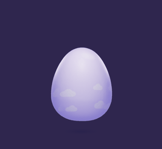 float</td><td align="center"> first crack</td><td align="center">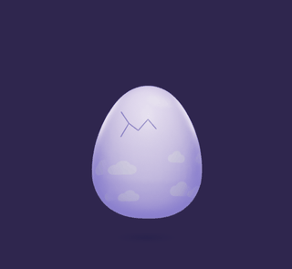 full crack</td><td align="center">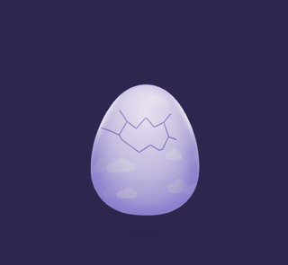 hatch</td><td align="center">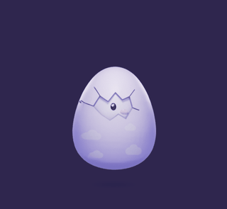 day 0–1</td></tr></table>

## Baby

<table><tr><td align="center"> idle</td><td align="center"> falling asleep</td><td align="center"> sleeping</td><td align="center"> waking up</td></tr></table>

## Teen

<table><tr><td align="center">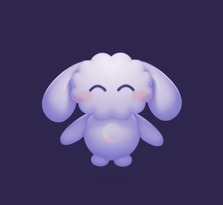 idle</td><td align="center"> falling asleep</td><td align="center">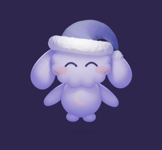 sleeping</td><td align="center">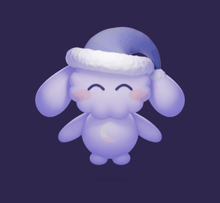 waking up</td></tr></table>

## Adult

<table><tr><td align="center"> idle</td><td align="center"> falling asleep</td><td align="center"> sleeping</td><td align="center"> waking up</td><td align="center">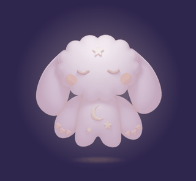 energized</td></tr></table>

## Night owl

<table><tr><td align="center"> idle</td><td align="center">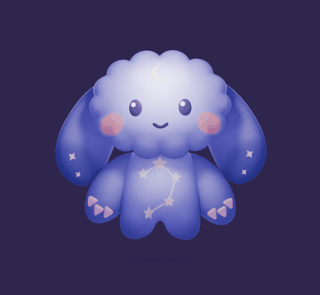 falling asleep</td><td align="center">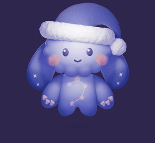 sleeping</td><td align="center">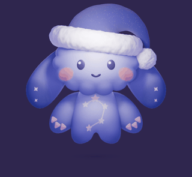 waking up</td><td align="center">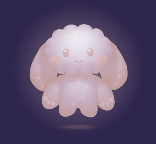 energized</td></tr></table>

## Early bird

<table><tr><td align="center">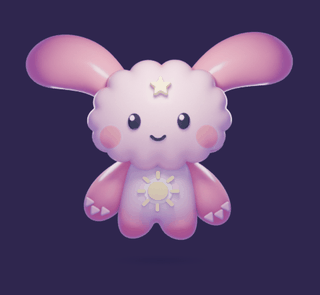 idle</td><td align="center"> falling asleep</td><td align="center">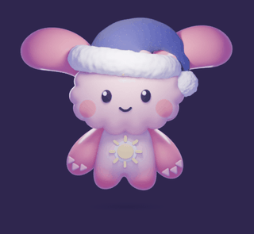 sleeping</td><td align="center">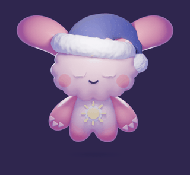 waking up</td><td align="center">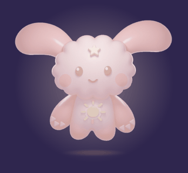 energized</td></tr></table>

## Upgraded

<table><tr><td align="center">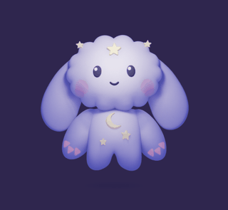 idle</td><td align="center"> falling asleep</td><td align="center"> sleeping</td><td align="center"> waking up</td><td align="center"> energized</td></tr></table>

## Stage changes

<table><tr><td align="center"> Egg → Baby</td><td align="center"> Baby → Teen</td><td align="center">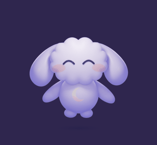 Teen → Adult</td></tr></table>

<table><tr><td align="center"> Adult → Night owl</td><td align="center"> Adult → Early bird</td><td align="center"> Adult → Upgraded</td></tr></table>
