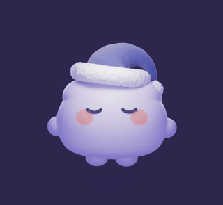
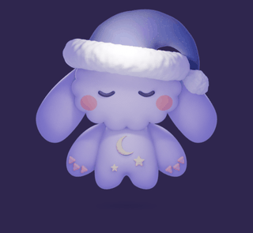
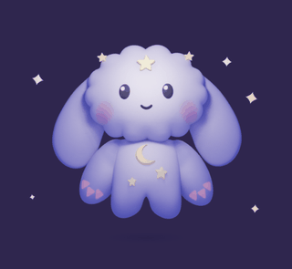
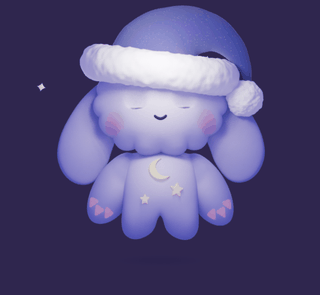
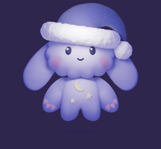
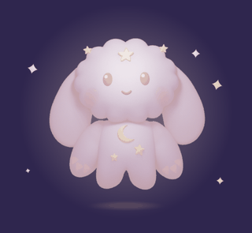
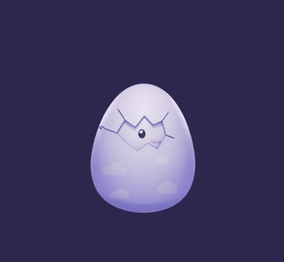
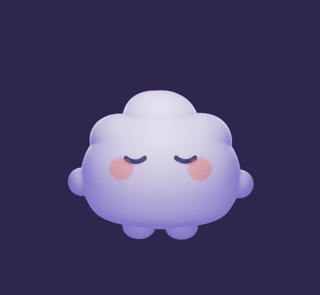
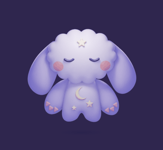

# Mamu

Animaciones de Mamu, la mascota de Somnus, para la app (480 px de ancho, 24 cuadros por segundo).

- `webp/`: WebP animado con fondo transparente, se repite solo; es el formato para la app.
- `gif/`: las mismas animaciones en GIF con fondo morado (320 px), para verlas aquí y compartirlas.
- `videos/`: MP4 con fondo morado; `all-models.mp4` y `all-transitions.mp4` juntan todo seguido.
- Cuadros PNG transparentes de cada animación: `mamu-frames.zip` en [Releases](https://github.com/ingmaxmendoza/mamu-animations/releases/tag/frames) (carpeta por etapa y animación, `0001.png`, `0002.png`, …).

## Huevo

<table><tr><td align="center"> flotar</td><td align="center"> primera grieta</td><td align="center"> grieta completa</td><td align="center"> eclosión</td><td align="center"> día 0–1</td></tr></table>

## Bebé

<table><tr><td align="center"> flotar</td><td align="center"> quedarse dormido</td><td align="center"> dormir</td><td align="center"> despertar</td></tr></table>

## Adolescente

<table><tr><td align="center"> flotar</td><td align="center"> quedarse dormido</td><td align="center"> dormir</td><td align="center"> despertar</td></tr></table>

## Adulto

<table><tr><td align="center"> flotar</td><td align="center"> quedarse dormido</td><td align="center"> dormir</td><td align="center"> despertar</td><td align="center"> con energía</td></tr></table>

## Búho nocturno

<table><tr><td align="center"> flotar</td><td align="center"> quedarse dormido</td><td align="center"> dormir</td><td align="center"> despertar</td><td align="center"> con energía</td></tr></table>

## Madrugador

<table><tr><td align="center"> flotar</td><td align="center"> quedarse dormido</td><td align="center"> dormir</td><td align="center"> despertar</td><td align="center"> con energía</td></tr></table>

## Mejorado

<table><tr><td align="center"> flotar</td><td align="center"> quedarse dormido</td><td align="center"> dormir</td><td align="center"> despertar</td><td align="center"> con energía</td></tr></table>

## Cambios de etapa

<table><tr><td align="center"> Huevo → Bebé</td><td align="center"> Bebé → Adolescente</td><td align="center"> Adolescente → Adulto</td></tr></table>

<table><tr><td align="center"> Adulto → Búho nocturno</td><td align="center"> Adulto → Madrugador</td><td align="center"> Adulto → Mejorado</td></tr></table>
